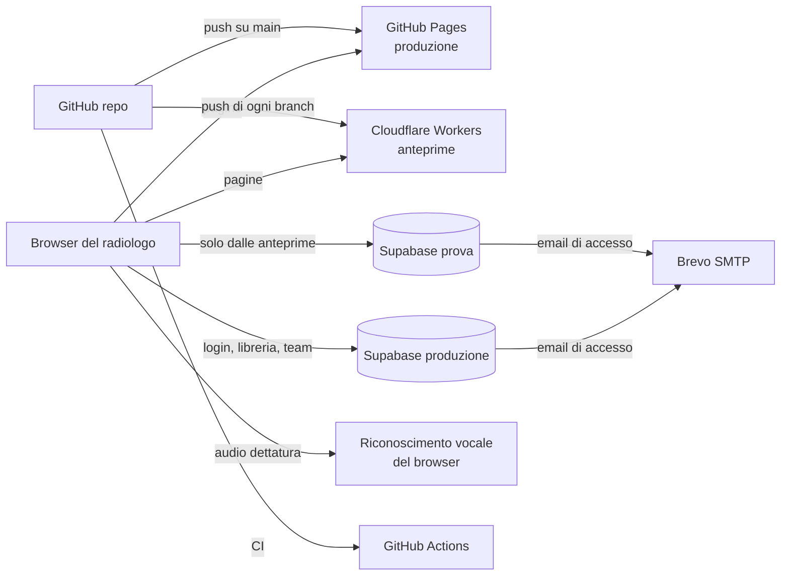

# Architettura di ModReport

Quadro d'insieme dell'architettura (aggiornato al 16/10/2026).
- Come si lavora e si pubblica: [`AGGIORNARE-IL-SITO.md`](AGGIORNARE-IL-SITO.md).
- Impostazioni delle dashboard: [`SUPABASE.md`](SUPABASE.md).

## 1. In una frase

**Sito statico** (HTML, CSS e JavaScript a moduli, **nessuna build**) che parla direttamente con **Supabase**:
- account e dati (libreria, profilo, team) stanno nel database;
- la protezione è nelle regole di accesso del database (RLS);
- i **referti** restano solo nel browser.

## 2. Servizi esterni

| Servizio | Indirizzo / ID | A cosa serve | Costo |
|---|---|---|---|
| **GitHub — repository** | `github.com/JGave99/ModReport` (proprietario JGave99) | codice, issue, pull request, tag di versione | gratis |
| **GitHub Pages** | <https://jgave99.github.io/ModReport/> | **sito di produzione**, pubblica `main` | gratis |
| **GitHub Actions** | `.github/workflows/ci.yml` | test automatici (lint, unit, SQL, e2e) su push a `main` e sulle pull request | gratis |
| **Cloudflare Workers** | worker `modreport`, account `iaco.gavesi@gmail.com` (ID `ebf3daea43b40041991a1f4c26d5b0ef`) | **anteprime** di ogni branch: `https://<branch>-modreport.iaco-gavesi.workers.dev`; `main` su <https://modreport.iaco-gavesi.workers.dev> | gratis |
| **Supabase — produzione** | progetto `umejthggxihtyqvcszgm` | login, database, file degli utenti reali | piano del progetto |
| **Supabase — prova** | progetto `modreport-prova` (`blwcqwajcjklgzgbfdfc`, UE) | come la produzione, ma per le prove: nessun dato reale | gratis |
| **Integrazione GitHub ↔ Supabase** | sul progetto di produzione | collegata, con *Deploy to production* **spento**: nessuna migrazione parte da sola | — |
| **Brevo** | SMTP `smtp-relay.brevo.com:587` | email di conferma, recupero password e cambio email, inviate da Supabase | gratis (300 email al giorno) |
| **Riconoscimento vocale del browser** | Google (Chrome), Microsoft (Edge), Apple (Safari) | dettatura: l'audio va al fornitore del browser, mai a ModReport; disattivabile | — |
| **Stripe** | — | **non attivo**: era il checkout del 18-24/09/2026, poi tolto; tornerà con lo Step 7 (vedi `SUPABASE.md` §4) | — |

Le credenziali (password, chiavi segrete, chiave SMTP, password dei database) **non stanno nel repository**: si tengono in un password manager.

## 3. Ambienti

| | Produzione | Prova |
|---|---|---|
| Sito | GitHub Pages (`main`) | Cloudflare (ogni branch, e `main`) |
| Database | Supabase `umejthggxihtyqvcszgm` | Supabase `blwcqwajcjklgzgbfdfc` |
| Chi decide | `js/config.js`: produzione **solo** sui domini in `PRODUZIONE` (oggi `jgave99.github.io`) | tutti gli altri domini, anche localhost |
| Uso | utenti reali | test con i colleghi |

Altre due modalità che **non usano nessun database**:
- **Backend finto**: `app.html?fake=1`, solo su localhost, per sviluppo e test e2e (`tests/fixtures/fake-supabase.js`).
- **Modalità locale**: "Prova senza account" (`?local=1`), tutto nel browser (`js/lib/local-backend.js`).

## 4. Il codice

### Pagine (`*.html` + `js/pages/*.js`)

| Pagina | Cosa fa |
|---|---|
| `index.html` / `landing.js` | homepage, video di presentazione, prezzi, FAQ |
| `app.html` / `app.js` | **editor del referto**: accesso, 5 schede, metodica → esame → indicazione → confronto → frasi, referto negativo, campi, dettatura, copia, stampa PDF, ricerca (Ctrl+K) |
| `account.html` / `account.js` | profilo, sicurezza (MFA), preferenze, abbreviazioni, **libreria delle frasi** (modifica, importazione, versioni, libreria del team), carta intestata, eliminazione account |
| `archivio.html` / `archivio.js` | archivio dei referti **solo locale** (IndexedDB), statistiche, CSV; sposta nel browser i vecchi referti rimasti nel cloud |
| `team.html` / `team.js` | team di studio o reparto: canali, messaggi, inviti, ruoli |
| `admin.html` / `admin.js` | solo amministratori: utenti, verifica dei professionisti |
| `tutorial.html` / `tutorial.js` | guida animata |
| `informativa-privacy.html`, `termini-servizio.html` | testi legali (dati in `js/legal-config.js`) |

### Moduli condivisi (`js/lib/`)

| Gruppo | Moduli |
|---|---|
| Collegamento | `supabase.js` (client unico), `session.js` (postazione condivisa, MFA, uscita per inattività), `auth-*.js` |
| Libreria | `library.js` (caricamento e salvataggio con controllo dei conflitti), `library-merge.js` (ID stabili, aggiornamento dei predefiniti), `library-versions.js`, `library-editor.js`, `default-library.js` + `library-base/` (frasi predefinite, v4) |
| Referto | `report-text.js` (inserimento ordinato, varianti, campi, referto negativo, controlli), `text-insert.js`, `voice-text.js`, `dictation.js`, `pdf.js` |
| Locale | `local-archive.js` (archivio IndexedDB), `local-backend.js` (modalità senza account), `archive-stats.js` |
| Interfaccia | `dom.js`, `toast.js`, `dialog.js`, `palette.js`, `import-analysis.js` |

### Configurazione (`js/`)

- `config.js`: ambienti e chiavi pubbliche di Supabase;
- `legal-config.js`: titolare, fornitori, versioni di termini e informativa;
- `site-config.js`, `pricing-config.js`: contenuti della landing;
- `pwa.js` + `sw.js`: app installabile e uso offline (prima la rete, poi la cache).

### Altro

| Percorso | Contenuto |
|---|---|
| `css/` | design system: `tokens.css`, `base.css`, `components.css`, `pages/` |
| `assets/` | logo, icone (`icons.svg`), immagini, `video/`, font e librerie in `vendor/` (supabase-js, pdf-lib, fontkit) |
| `extension/` | **prototipo** di estensione Chrome "ModReport sopra il RIS" (non pubblicata) |
| `labs/` | **prototipo** di dettatura locale con Whisper (sospeso) |
| `scripts/` | server locale, controlli, icone, screenshot, copia delle librerie |
| `tests/` | `unit/` (Node), `sql/` (RLS su PGlite), `e2e/` (Playwright sul backend finto) |
| `supabase/migrations/` | schema del database, un file per modifica |
| `_headers` | header di sicurezza e CSP per Cloudflare (GitHub Pages usa i meta tag nelle pagine) |
| `wrangler.jsonc`, `.assetsignore` | configurazione Cloudflare e file da non pubblicare |

## 5. Database (Supabase)

### Tabelle

| Area | Tabelle |
|---|---|
| Utente | `profiles` (nome, titolo), `user_data` (**libreria personale** in JSON, con abbreviazioni e referto negativo), `library_versions` (ultime 30 copie), `letterheads` (carte intestate) |
| Team | `teams`, `team_members`, `team_invites`, `team_libraries`, `channels`, `messages`, `channel_reads` |
| Amministrazione | `app_admins`, `verification_requests` |
| Legale | `consent_log` (accettazione di termini e informativa) |
| Versione precedente | `app_presets` (libreria base copiata ai nuovi utenti da `copy_base_preset_to_new_user`), `subscriptions` (abbonamenti Stripe del 18-24/09, Step 7): restano, non più usate dal codice |
| Storico | `report_archive`: referti salvati nel cloud dalle versioni vecchie; l'app li sposta nel browser e li cancella |

### Storage (file)

- `letterheads`: PDF della carta intestata;
- `verifiche`: documenti per la verifica del professionista.

Entrambi privati, ciascun utente vede solo la propria cartella.

### Regole

- **RLS** su tutte le tabelle: ognuno vede solo i propri dati; nel team, solo i membri.
- **MFA**: chi ha attivato la verifica in due passaggi deve usarla per accedere ai dati (policy `mfa_required`).
- **Funzioni RPC** per le operazioni delicate: `create_team`, `create_team_invite`, `join_team_with_code`, `leave_team`, `remove_team_member`, `set_team_member_role`, `revoke_team_invite`, `accept_terms`, `delete_my_account`, `list_app_users`, `update_my_display_name`, `my_channels_last_message`.
- **Trigger di guardia**: date, autori e campi protetti li decide il server, non il browser.

## 6. Dove stanno i dati

| Dato | Dove |
|---|---|
| Referti (testo) | **solo nel browser**: bozza in sessionStorage (si perde chiudendo la scheda), archivio in IndexedDB |
| Dati del paziente nella stampa | solo nel PDF generato, mai salvati |
| Libreria delle frasi, abbreviazioni, scelta del referto negativo | Supabase `user_data`, con copia locale per l'offline |
| Profilo, team, messaggi | Supabase |
| Audio della dettatura | fornitore del browser (Google, Microsoft o Apple) |
| Email degli utenti | Supabase (account) e Brevo (invio delle email) |

## 7. Flusso di rilascio

1. Branch → push.
2. Anteprima su Cloudflare, che usa il database di prova; prova con i colleghi.
3. Le migrazioni SQL nuove si applicano a mano: prima sul progetto di prova, poi in produzione dopo il backup.
4. Pull request → CI verde → merge su `main`.
5. GitHub Pages aggiorna la produzione.
6. Tag di versione (`v0.1.0` = sito prima delle migliorie dell'audit) e `CHANGELOG.md`.
